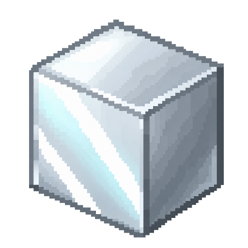
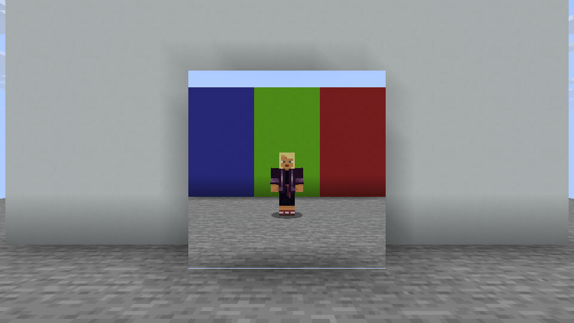

# Simply Mirrors



[Release and CurseForge setup](docs/releasing.md)

A standalone Minecraft mod project for placeable mirrors that reflect the surrounding world.

**Status: experimental development build.** Includes a craftable full-block frameless mirror, a dedicated Simply Mirrors creative tab, and native reflection adapters for all four Minecraft versions. Reflection geometry is adapted from Immersive Portals CE; no portal mod is required. Runtime acceptance is tracked per target; the first verified capture is shown below.

Every face of the full solid cube reflects: north, south, east, west, top, and bottom. Placement direction does not limit reflections. Adjacent mirrors form continuous surfaces, including floors and ceilings. Build your own frame using any blocks you like. Take a mirror from the Simply Mirrors tab or craft one with eight glass blocks around an iron ingot.

The renderer is bounded to six visible mirror planes per frame within 32 blocks. Coplanar mirrors share a reflection render, and internal faces between neighboring mirrors are skipped. More visible planes cost additional world renders. Reflections show loaded terrain and entities; recursive mirror reflections and shader-pack compatibility are not yet supported. The 26.1.2 compositor currently targets Minecraft's OpenGL renderer.



The capture shows the player and colored blocks behind the camera reflected in a 3 x 3 mirror surface, with a solid wall behind the glass.

## Target matrix

| Minecraft | Fabric | Forge / NeoForge | Java |
|---|---|---|---|
| 1.16.5 | Fabric | Forge 36.2.42 | 8 |
| 1.20.1 | Fabric | Forge 47.4.0 | 17 |
| 1.21.1 | Fabric | NeoForge 21.1.228 | 21 |
| 26.1.2 | Fabric | NeoForge 26.1.2.76 | 25 |

Each row produces two separate jars; install only the artifact matching your Minecraft version and loader. Forge is used for the older versions, NeoForge for the newer versions. Fabric builds require Fabric API. Forge and NeoForge builds need only their matching loader; Architectury API and Immersive Portals are not runtime dependencies.

## Build

Install Python 3.11+ and JDK 21 for the legacy build and JDK 25 for the 26.1.2 builds. Gradle toolchains resolve the compilation JDKs (8, 17, 21, 25). Set `JAVA_HOME` to JDK 21 for legacy commands or JDK 25 when building Minecraft 26.1.2. No machine-specific paths are checked in.

```sh
python tools/build.py                       # shared tests + all eight production jars
python tools/build.py --target forge-1.16.5 # tests + one target
```

On Windows, use `gradlew.bat` instead of `./gradlew` for direct Gradle commands:

```sh
./gradlew -Ptarget=common :common:test
./gradlew -Ptarget=fabric-1.20.1 :fabric-1.20.1:build
cd fabric-26.1.2
./gradlew build
```

The root wrapper is Gradle 8.14. Forge 1.16.5 uses its own Gradle 8.14 build with ForgeGradle 6.0.54 and MixinGradle 0.7.38, avoiding Loom's incomplete remapping of Forge's legacy coremods. Each 26.1.2 module has an independent Gradle 9.2.1 wrapper because the Minecraft 26 toolchain differs from the older Loom builds. `tools/build.py` selects the correct build root and verifies each production jar's metadata, entrypoint, included shared classes, and Java bytecode level.

## Development client

The Forge 1.20.1 development client includes JEI 15.20.0.106 for browsing mirror items and recipes. JEI is a development-only dependency and is not bundled with Simply Mirrors or published as a required dependency.

```sh
./gradlew -Ptarget=forge-1.20.1 :forge-1.20.1:runClient
```

## Layout

- `common`: loader- and Minecraft-independent Java 8 sources and reflection-math regression tests.
- `common-<version>`: locations reserved for version-specific Minecraft integrations shared by both loaders.
- `fabric-<version>`, `forge-<version>`, `neoforge-<version>`: platform bootstraps, exact-version metadata, and development launch configurations.
- `tools/targets.json`: complete eight-target packaging matrix.
- `.github/workflows/build.yml`: shared tests and separate artifact builds for every target on pushes and pull requests.

## Validation

Shared tests cover CE vector/matrix parity, inverse transforms, glass projection alignment, oblique wall clipping, and coplanar grouping. Every production artifact is checked for version/loader identity, Java level, block/item resources, mixin metadata, and license notices. The isolated visual workflow launches a disposable dedicated server and client, places an asymmetric red/green/blue fixture behind the player and an opaque wall behind the mirrors, then checks the captured reflection's colors, handedness, completed render passes, creative tab, and OpenGL error state. Artifacts include the capture and logs for each target. The fixture is rebuilt in all six orientations, checking side walls, floors, and ceilings independently of the saved placement direction. Each orientation also exercises angled views and must complete at least 120 reflection frames before capture.

To run one target locally, install Pillow and use `python tools/visual_smoke.py --target fabric-1.20.1`. Linux CI supplies Xvfb and Mesa software rendering. The script refuses to reuse an existing test world. Test probes are compiled into a separate build directory and are rejected by the production packaging check.

## Rendering implementation

Each exposed cube face defines its own reflection plane; the legacy placement-facing property is retained only for compatibility with existing blocks. The camera position and view are reflected using Immersive Portals CE's vector reflection and reflection matrix. A version adapter renders the same world to an offscreen target with an oblique near plane at the glass, then projects that texture onto the full mirror face with world depth testing. This excludes blocks behind the mirror and prevents the wall from obscuring the reflected room. Render targets and projection resources are released on world unload and shutdown.

## License

Original Simply Mirrors code is MIT, copyright 2026 NsTut. Adapted Immersive Portals CE reflection-transform code remains Apache-2.0, copyright qouteall and contributors; see [NOTICE](NOTICE) and [the bundled license](licenses/Immersive-Portals-CE-Apache-2.0.txt). Part of the Simply series alongside [Simply Speakers](https://github.com/UpperMoon0/Simply-Speakers) and [Simply Screens](https://github.com/UpperMoon0/Simply-Screens).
