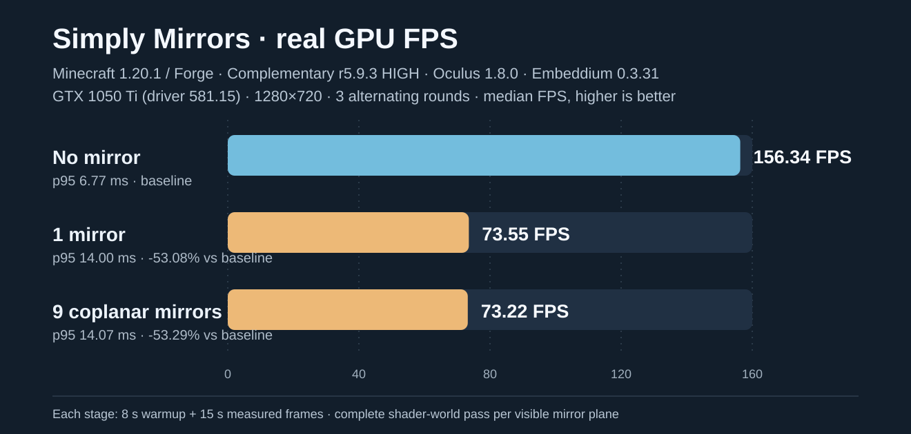

# Real Minecraft + Complementary hardware GPU benchmark — 2026-11-05

## Real test environment

A **real Minecraft 1.20.1 graphical client** connected to an isolated dedicated Forge 47.4.0 server on **on-prem-1**. Hardware: NVIDIA GTX 1050 Ti (4 GiB), driver 581.15; Intel Core i3-8100; Windows 10; Java 17 for the game. Shader stack: **Complementary Reimagined r5.9.3 HIGH**, Oculus 1.8.0 and Embeddium 0.3.31. Shader ZIP SHA256: fed6c879e732cf7fc7bc6570ebb1def43235aa7e96f62859fbdbdbfa0b484b38.

Resolution **1280×720**, render distance 4, fast graphics, VSync off, FPS cap 260, fixed camera, same enclosed-world fixture and time/weather. The isolated client ran in the active graphical Windows session with **its own non-minimized GLFW window moved offscreen**, without modifying any PrismLauncher profile or active user windows.

This exercised the production mirror renderer from **PR #8**, with the benchmark-only sources on SHA fe141dbdfbd1a22ff147dcd2c9a4b459d2872851. Three alternating rounds used **baseline / one / nine**, then **nine / one / baseline**, then **baseline / one / nine**. Each trial had **8 s warmup, 15 s measured frames**. The in-game renderer recorded every actual end-of-frame interval, not software-OpenGL geometry-only timings. FPS is measured frames divided by summed frame-interval seconds.

## Measured results

| Mirror scene | Round 1 FPS | Round 2 FPS | Round 3 FPS | Median FPS | Median p95 frame time | Median FPS change vs same-round baseline |
| --- | ---: | ---: | ---: | ---: | ---: | ---: |
| No mirror | 156.336 | 156.746 | 155.800 | **156.336** | **6.767 ms** | baseline |
| One mirror | 74.386 | 73.545 | 72.677 | **73.545** | **14.000 ms** | **−53.08%** |
| Nine coplanar mirrors | 73.290 | 73.220 | 72.309 | **73.220** | **14.073 ms** | **−53.29%** |

The three paired percentage losses were −52.42%, −53.08%, −53.35% (one mirror) and −53.12%, −53.29%, −53.59% (nine coplanar mirrors). All rounds showed broadly comparable costs for one and nine mirror blocks on the same plane; multiple independent planes remain an untested heavier workload.

**13,632 actual rendered frame intervals** were retained: 7,036 baseline, 3,312 one-mirror, 3,284 nine-mirror. Each mirror frame generated one completed reflected-world pass. Shader activation, NVIDIA GL renderer, unminimized window and GL-no-error assertions all passed. In every round, the nine-mirror screenshot verified correct reflected red/green/blue marker order, and the one-mirror screenshot differed from baseline by 15,558–15,570 pixels in the center crop. The nine genuine render screenshots, raw client/server logs and GPU samples remain in the isolated on-prem-1 run directory named fps-20261105-o3.

NVIDIA snapshot readings were typically near 2 GiB VRAM used and frequently 99% GPU utilization; these are **snapshot diagnostics, not accurate GPU time-per-pass measurements**. Minecraft and the dedicated server shut down cleanly, and the benchmark runner exited **0**.

## Full versioned raw evidence

Every linked scenario file retains **all measured frame intervals in nanoseconds**, reflection passes per frame, shader status, GL vendor/renderer and summary timing statistics.

- [Verified machine/configuration summary and image checks](benchmarks/onprem1-20261105/summary.json)
- Round 1: [baseline](benchmarks/onprem1-20261105/scene-7.json), [one mirror](benchmarks/onprem1-20261105/scene-8.json), [nine mirrors](benchmarks/onprem1-20261105/scene-9.json)
- Round 2, reversed order: [nine](benchmarks/onprem1-20261105/scene-19.json), [one](benchmarks/onprem1-20261105/scene-18.json), [baseline](benchmarks/onprem1-20261105/scene-17.json)
- Round 3: [baseline](benchmarks/onprem1-20261105/scene-27.json), [one](benchmarks/onprem1-20261105/scene-28.json), [nine](benchmarks/onprem1-20261105/scene-29.json)

Reproduction instructions: [real GPU benchmark harness](REAL_GPU_FPS.md). The raw inputs and chart above are committed to PR #10 for review. Hardware FPS is not interchangeable with previous Mesa llvmpipe compositor-only measurements.

## Implications

**A single mirror cuts FPS approximately 53% in this controlled shader scene even with PR #8's shader-history buffer allocation optimization.** The main expense is consistent with the full extra Minecraft world / Oculus / Complementary pipeline per visible reflection plane; nine coplanar blocks add little incremental cost. This benchmark measures the aggregate performance loss but **does not yet prove** exact GPU milliseconds spent in shadow rendering, gbuffers, composite, history blits or driver stalls. Add per-stage GPU timer queries and verify visual parity before claiming a root-cause optimization.

This simple 720p fixture is not the user's heavier scenario with FPS reaching ~10, and does not establish that the rendering performance bug is solved.
