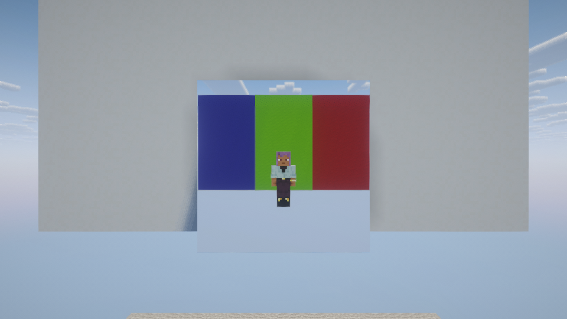
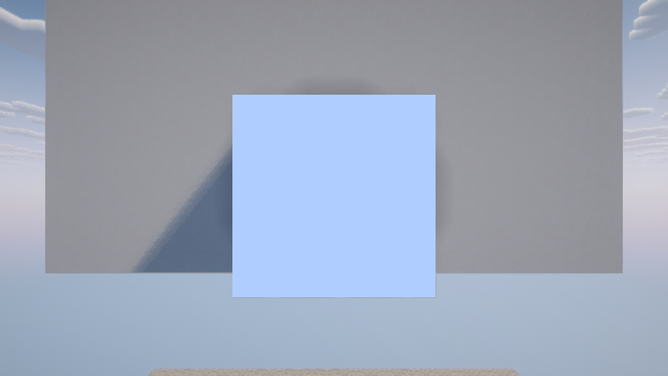

# Shader validation

The 0.1.1 renderer adds standalone Iris/Oculus integration. Shader mods and Complementary remain optional development dependencies and are never bundled in the production mod.

## What changed

- Keep perspective projection for shader depth reconstruction. Clip world geometry at the mirror using a view-space plane in the final vertex-producing stage, including geometry and tessellation evaluation output.
- Suspend mirror clipping and reflected winding during shadow maps and fullscreen processing. Iris 1.11.4 uses GPU render passes for composites and finals, so hooking the older fullscreen-quad method alone is insufficient.
- Enable depth writes before clearing a reflection target. Oculus final processing leaves depth writes disabled, and OpenGL depth clears obey that mask.
- Compare depth texture identity when changing targets. Separate framebuffers can share the same allocation-version number.
- Give modern Sodium the reflected projection and rebuild visibility for the reflected camera rather than reusing an asynchronous main-camera result.

The implementation follows the relevant rendering contracts in the owner's CE sources, [Oculus 1.20.1](https://github.com/Asek3/Oculus/tree/1.20.1-new), [Sodium 0.9.2 for 26.1.2](https://github.com/CaffeineMC/sodium/tree/mc26.1.2-0.9.2), and [Iris's 26.1 rendering path](https://github.com/IrisShaders/Iris/tree/bff1e69cb6c5519d8745784aa9c8b92984de67e7). The installed Iris 1.11.4 bytecode also confirms the final pass calls `RenderPass.drawIndexed`, not `renderQuad`.

## Native capture

NeoForge 26.1.2 with Iris 1.11.4, Sodium 0.9.2, Complementary Reimagined r5.9.3, and an NVIDIA GTX 1050 Ti passed all six orientations, including 120 reflected frames and 120 angled-view frames per orientation. Each result reported an active shader pack and no OpenGL error.



The full eight-target CI matrix remains the acceptance gate; a native result for one target does not establish the others.

## Reproduction

Use JDK 21 for older targets and JDK 25 for 26.1.2 Gradle builds, plus Python 3.11+ with Pillow. The game uses each target's matching Java toolchain.

```sh
python tools/visual_smoke.py --target forge-1.20.1 --shaders --run-name shader-check
```

The installer downloads checksum-pinned native artifacts. Forge 1.16.5 uses Oculus/Rubidium; Forge 1.20.1 uses Oculus/Embeddium; Fabric and modern NeoForge use Iris/Sodium. All stacks use Complementary Reimagined r5.9.3. Fabric 1.16.5 uses the same upstream SLF4J 1.7.12 library without Iris's generated mod metadata: Loader 0.16's preloaded logging-jar resource lookup otherwise hides the development mods. Third-party downloaded jars are not modified.

Each run starts a disposable server without shader mods and a shader-enabled client. The fixture includes an opaque wall behind the mirrors and asymmetric colored markers behind the player. Time is fixed at noon and weather is stable, so slower software rendering cannot accidentally turn later captures into nighttime tests. Vanilla color checks remain unchanged. Shader checks require substantial red, green, and blue regions in reflected order while allowing directional shading and warm lighting; flat-blue output still fails.

Logs and results are written under `<target>/run/<run-name>-evidence`; captures are under `<target>/run/<run-name>-client/visual-evidence`. Only a fully passing run writes `verified.json`. Image mismatches are retained while remaining faces are captured; the run then fails. The harness refuses to reuse a saved world, so retries need a fresh run name.

## Released 0.1.0 baseline

The old renderer produced a flat blue mirror despite an active shader pack, 120 completed reflection passes, and `glError=0`. The acceptance tests reject this result.


