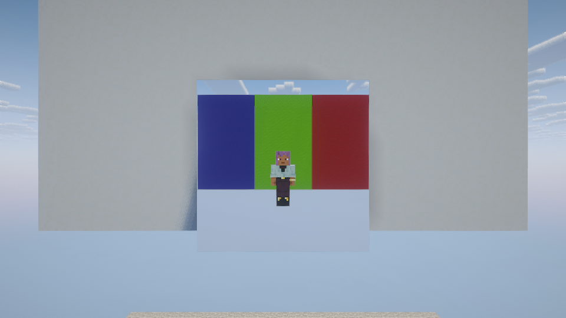

# Shader validation

Simply Mirrors supports optional Iris/Oculus shaders while preserving the reflected world's geometry, entities, camera state, and clipping. Shader loaders, terrain renderers, and shader packs are client-side options; they are not bundled with the production mod.

## Rendering behavior

- Keep perspective projection for shader depth reconstruction. Clip world geometry at the mirror using a view-space plane in the final vertex-producing stage, including geometry and tessellation evaluation output.
- Disable clip distances for unpatched sky/fallback programs; restore them when a transformed world program is bound. Fallback shaders bind programs directly, bypassing Iris's uniform updater.
- Suspend mirror clipping and reflected winding during shadow maps and fullscreen processing. Iris 1.11.4 uses GPU render passes for composites and finals, so hooking the older fullscreen-quad method alone is insufficient.
- Enable depth writes before clearing a reflection target. Oculus final processing leaves depth writes disabled, and OpenGL depth clears obey that mask.
- Compare depth texture identity when changing targets. Separate framebuffers can share the same allocation-version number.
- Give modern Sodium the reflected projection and rebuild visibility for the reflected camera rather than reusing an asynchronous main-camera result.

The implementation follows the relevant rendering contracts in the owner's CE sources, [Oculus 1.20.1](https://github.com/Asek3/Oculus/tree/1.20.1-new), [Sodium 0.9.2 for 26.1.2](https://github.com/CaffeineMC/sodium/tree/mc26.1.2-0.9.2), and [Iris's 26.1 rendering path](https://github.com/IrisShaders/Iris/tree/bff1e69cb6c5519d8745784aa9c8b92984de67e7). The installed Iris 1.11.4 bytecode also confirms the final pass calls `RenderPass.drawIndexed`, not `renderQuad`.

## Reflection framebuffer compatibility

Shader-enabled mirrors match the main camera's depth texture storage when needed and keep reflected rendering isolated from the main view. Some client rendering stacks attach packed stencil images separately from their depth textures. If an Iris reflection framebuffer becomes incomplete when its depth attachment is replaced, Simply Mirrors can temporarily detach the incompatible stencil attachment, then restore the attachment topology and caller bindings after the reflection. Complete main-camera framebuffers are left untouched.

The renderer also handles stencil replacement during a reflection and preserves single-layer, cube-face, and full-texture attachments when restoring state. These safeguards target the supported Iris/Oculus rendering integration and do not guarantee every shaderpack or GPU driver combination.

CI verifies the repair with native OpenGL attachment-state tests and in-game shader captures. For the original incident, reproduction conditions, and full-modpack diagnostic evidence, see the [release notes](../changelog/0.1.2.md).

## Compatibility verification

NeoForge 26.1.2 with Iris 1.11.4, Sodium 0.9.2, Complementary Reimagined r5.9.3, and an NVIDIA GTX 1050 Ti passed all six orientations, including 120 reflected frames and 120 angled-view frames per orientation. Each result reported an active shader pack and no OpenGL error.



The full eight-target CI matrix remains the acceptance gate; a native result for one target does not establish the others.

## Reproduction

Use JDK 21 for older targets and JDK 25 for 26.1.2 Gradle builds, plus Python 3.11+ with Pillow. The game uses each target's matching Java toolchain.

```sh
python tools/visual_smoke.py --target forge-1.20.1 --shaders --run-name shader-check
```

The installer downloads checksum-pinned native artifacts. Forge 1.16.5 uses Oculus/Rubidium; Forge 1.20.1 uses Oculus/Embeddium; Fabric and modern NeoForge use Iris/Sodium. All stacks use Complementary Reimagined r5.9.3. Fabric 1.16.5 uses the same upstream SLF4J 1.7.12 library without Iris's generated mod metadata: Loader 0.16's preloaded logging-jar resource lookup otherwise hides the development mods. Third-party downloaded jars are not modified.

Each run starts a disposable server without shader mods and a shader-enabled client. The fixture includes an opaque wall behind the mirrors and asymmetric colored markers behind the player. Time is fixed at noon and weather is stable, so slower software rendering cannot accidentally turn later captures into nighttime tests. Vanilla color checks remain unchanged. Shader checks require substantial red, green, and blue regions in reflected order while allowing directional shading and warm lighting; flat-blue output still fails.

Logs and results are written under `<target>/run/<run-name>-evidence`; captures are under `<target>/run/<run-name>-client/visual-evidence`. Only a fully passing run writes `verified.json`. Image mismatches are retained while remaining faces are captured; the run then fails. The harness refuses to reuse a saved world, so retries need a fresh run name.

## Failure detection

Shader acceptance rejects a sky-only or flat-blue reflection even if the shaderpack is active, reflection passes complete, and OpenGL reports no immediate error. The visual fixture checks for correctly ordered colored world geometry, entities, and handedness rather than treating a successful draw counter as proof of correct rendering.

## Camera and temporal-state isolation

Each reflected pass overrides camera-dependent uniforms without advancing Iris's frame counter or camera-history suppliers. The main camera, shadow matrices, and GPU uniform values are restored afterward. Persistent color textures are saved on both main/alternate sides, including allocated mip levels and sampler state, then restored even if a reflected render fails.

Reflections start with cleared temporal color history rather than borrowing the main view's previous accumulation. The pinned Complementary TAA shader rejects that empty history and uses the current reflected color, preserving the main camera's accumulated TAA; reflections do not yet accumulate separate per-mirror TAA color history.

For **motion blur and velocity reconstruction**, the shader receives the actual previous main-camera view/projection and eye reflected across the **same static mirror plane** as the current pass. The first frame of a new world seeds its previous pose from the current frame; later frames retain genuine camera pan/strafe velocity. Previous camera GPU uniforms respect Iris's origin-relative position and are always restored after the reflection. This prevents main-camera motion from becoming spurious reflected motion without forcing a zero-velocity mirror. A scoped NeoForge 1.21.1 visual acceptance test enables the pinned Complementary pack's `MOTION_BLUR_EFFECT=1` and `TAA_DEFINE=1`, captures idle, first moved, and settled reflected frames, and checks actual displacement and bounded motion ghosting. These checks cannot prove full shader quality on hardware GPU drivers.

The `Shader history isolation (OpenGL)` CI check exercises the production texture transaction in a real software-rendered OpenGL context, including repeated exception paths and exact image/state restoration. Its Iris API-shaped fixtures test the bridge without launching Minecraft. See [the native regression instructions](../tools/gl-tests/README.md). Shared Java tests separately cover camera-uniform restoration, multiple mirror planes, shadow matrices, mutable captured matrices, and interrupted updates. These focused checks supplement the eight-target in-game shader captures; they are not substitutes for them.

## Reproducing third-party shader conflicts

The normal smoke test uses the repository's checksum-pinned shader dependencies.
When the plain NeoForge shader lane passes but a larger modpack displays only sky,
use a **fresh, disposable** client profile with selected rendering mods from that
pack, and the exact shaderpack ZIP. Never point this runner at a personal save.

```sh
python tools/visual_smoke.py --target neoforge-1.21.1 --shaders \
  --shader-pack /path/to/tested-shaderpack.zip \
  --extra-client-mod /path/to/modpack-render-addon.jar \
  --run-name modpack-render-repro
```

Repeat `--extra-client-mod` for each client-only mod needed to reproduce the
interaction. Client mods that also need a server-side counterpart are not
supported by this option and require a separately configured test fixture.
This does **not** attempt to install a full modpack or its server dependencies.

The runner records SHA-256 hashes of added jars and shaderpack in its evidence
directory; it checks six reflection directions and requires reflected colored
geometry rather than accepting sky-only output as a pass. If this test fails,
retain logs, screenshots, the affected renderer versions and the smallest
reproducible combination before changing production shaders or declaring
compatibility. A passing plain shader smoke test does not certify ATM modpacks.


### Enclosed-room shader regression

A sky-only reflection can be missed by an open-air smoke fixture. Add
`--enclosed` when checking reports involving indoor mirrors. The disposable
server builds opaque side walls, floor, ceiling, and a wall around the mirror,
then keeps the distinct colored objects *inside* the room for all six face
orientations. Internal sea lantern strips provide block light without removing
the opaque enclosure: a fully sealed, unlit room may expose almost-black
geometry in physically shaded shader packs, which can look like a missing
reflection. The existing image checks still require colored reflected objects
in the correct order, not merely a successful shader render pass.

```sh
python tools/visual_smoke.py --target neoforge-1.21.1 --shaders \
  --enclosed --run-name indoor-reflection
```

The CI shader workflow compares the same illuminated enclosed fixture both
with and without an additional shader modifier. Inspect the preserved screenshots
before classifying failures: absent geometry, underexposure, and a genuinely
sky-only capture require different repairs. A failure in the modifier lane
without a matching failure in the enclosed baseline narrows the integration
surface; it does not by itself prove an Euphoria rendering defect.

The CI shader workflow also runs an isolated test with a checksum-pinned
client-side shader modifier found in a large modpack. Its exact third-party
version and digest are recorded in the workflow. This targeted case cannot
substitute for a full installed-modpack reproduction, which may depend on
additional rendering mixins and client configuration.

The Iris shader transform hook captures its program-name argument directly
at RETURN, without global state or a HEAD/RETURN push/pop lifecycle. A failed
shaderpack reload therefore cannot leave a stale transform context on a worker.
Focused Java regressions cover invalid source followed by valid world and
non-world transforms. This protects shader classification, but does not itself
establish compatibility with a full client modpack.

### Reflected entity acceptance (NeoForge 1.21.1)

The enclosed Complementary and Euphoria acceptance jobs also require a player
silhouette in the center of the green reflected marker, not merely a correctly
colored room. This detects a failure mode where wall markers render
without the reflected player. The fixed, normalized center region is compared
to the adjacent green surface; the assertion is scoped to the pinned NeoForge
1.21.1 enclosed scene and is not imposed on other loaders or personal skins.
Synthetic negative tests prove a correctly colored room with no player fails.
This complements, but cannot replace, real shader transitions or GPU tests.

### Precise main-target stencil reproducer

Some NeoForge client mods enable stencil bits on the main framebuffer.
When a shader pipeline substitutes a depth-only mirror texture but retains a
separate packed stencil attachment, the reflection framebuffer may become
unsupported. The scoped reflection repair handles this condition without
modifying complete main-camera framebuffers.

The enclosed NeoForge 1.21.1 shader jobs reproduce this public rendering state
by calling `RenderTarget.enableStencil()` from an opt-in QA-only render-thread
hook. They verify that stencil was enabled and that reflected geometry and
the player are visible across all six orientations. The test requires only
the relevant rendering stack, not a particular modpack or stencil-enabling mod.

### Animated reflected-entity check

The targeted NeoForge 1.21.1 shader acceptance captures a player's
reflection before and during a deliberate main-hand swing, with an unchanged
camera angle. Pixel differences in the reflected entity region must be visible;
a static or frozen player reflection fails. Slow software-OpenGL test
clients hold only the test actor's mid-swing animation state long enough for
several completed reflection frames; this tests pose rendering, not real-time
animation cadence. Other five faces still require
stencil-enabled, six-orientation geometry and player-silhouette checks.
